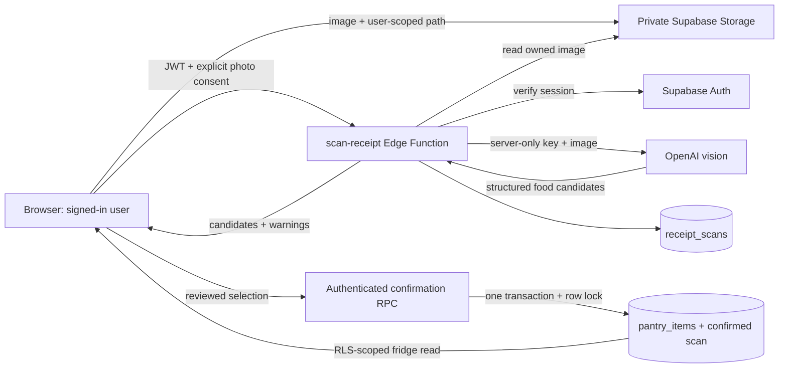

# 60–90 second technical demo

Before presenting, sign in, test the connection, and run a practice scan. Use the synthetic image at `public/sample-receipt.png` if you do not want to show a real purchase. Keep an empty test fridge ready.

1. **0–10 seconds:** “Ingredi helps you cook what you have and waste less. This is our working backend demo, separate from the Figma prototype.”
2. **10–30 seconds:** Choose **Scan a receipt**, upload the image, approve the OpenAI transfer, and choose **Read my receipt**. “A private upload is read by an authenticated Edge Function. Our AI key stays on the server.”
3. **30–50 seconds:** Show extracted food items and skipped non-food items. Change a quantity, skip a line, and optionally enter a best-before date. “The user checks what goes into their fridge; we do not guess expiry dates.”
4. **50–65 seconds:** Confirm. Show the new fridge cards. Refresh. “These ingredients are stored in Supabase, scoped to my account.”
5. **65–90 seconds:** Show matching recipes or the Supabase table editor. “The save is transactional and retry-safe. Cross-user access and reward-counter forgery are blocked.”

## Reliable fallbacks

For an installed iPhone demo or the Mac iPhone Simulator, see [the iOS demo setup](IOS-DEMO.md). In the native app, **Load demo photo for live AI** runs the real extraction against the bundled synthetic receipt; **Use the sample receipt** is the preset fallback.

- If there is no AI key or the provider is slow, use **Use the sample receipt** while signed in. Say: “This run uses preset extraction; confirmation still writes to our real backend.”
- If Auth or the network is unavailable, sign out and use the labeled local sample mode. Say: “This is the offline UI fallback, saved on this device.”
- The app never silently presents sample data as live AI.
- For a prerecorded backup, record the above journey once on the presentation computer before the event. No recording is included in this repository.

## Architecture

## Verified during implementation

- Healthy connected project and all six existing tables inspected.
- 20 Node tests pass, including mocked live vision responses, auth rejection, missing-key handling, malformed image/output rejection, receipt weight normalization, consent, explicit fallback labeling, safe provider error diagnostics and quota/rate-limit distinctions.
- 10 integration tests pass against the real PostgreSQL database: cross-user isolation, protected counters, protected receipt linkage, server-only scan writes, atomic rollback, successful confirmation, and replay without duplicate pantry rows. Test fixtures were rolled back.
- Security advisor returns no findings after both migrations.
- Browser QA: local sample review/edit/skip/save, persistence after refresh, correct present/missing recipe matches, desktop and 390px phone layouts.
- Hosted `scan-receipt` function is ACTIVE and rejects unauthenticated requests with HTTP 401.

## Completed real live test — November 7, 2026

The user signed in, configured the server-side key and funded the API account. The browser uploaded `sample-receipt.png` to the private bucket and explicitly approved the OpenAI transfer. The server verified the Auth session and OpenAI returned 7 food candidates while skipping 3 non-food products.

In review, milk was renamed and changed to 2 gal, the food names were cleaned up, the spinach date was set to November 10, and the abbreviated onion line was skipped. Confirmation saved exactly 6 receipt-source pantry rows. A page reload fetched all 13 fridge rows: the 7 existing sample rows plus the 6 new live rows. The edited quantity and spinach date persisted.

Replaying confirmation as the owning database role returned `already_confirmed: true`, count 6, with the stored count remaining 6. The replay check was rolled back and did not alter the user's data. Row-locking/unique receipt-line protection and the existing 10 database integration tests cover duplicate prevention and isolation. A concurrent HTTP confirmation test was not performed.

Earlier quota failures now show specific API billing instructions and store only safe error codes/status/request IDs. Receipt weights with more than two decimal places are normalized with a visible review warning; the original receipt line is retained. The original unclassified validation failure did not retain the raw model output, so its exact cause was not recovered.

The latest security advisor reports [leaked-password protection disabled](https://supabase.com/docs/guides/auth/password-security#password-strength-and-leaked-password-protection). Enable it before production use where supported. No database RLS/grant findings were reported.

Proof images are saved locally in `artifacts/live-ingredient-review.jpg`, `artifacts/live-receipt-success.jpg`, and `artifacts/live-fridge-after-refresh.jpg` (ignored by Git).
